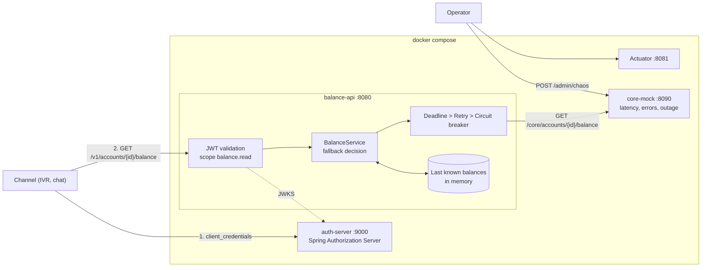
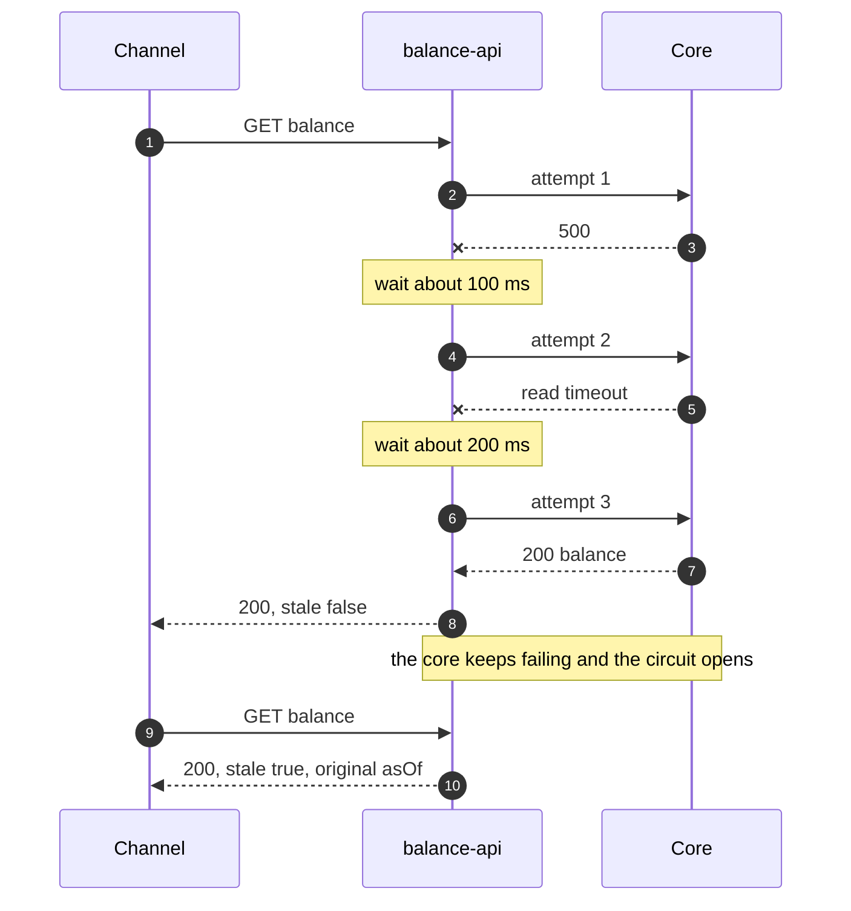

# balance-gateway

[](https://github.com/jcorta/balance-gateway/actions/workflows/ci.yml)

Reference implementation of a resilient integration service between customer-facing channels (IVR, chat) and a slow, unreliable core banking system. Channels authenticate as systems with OAuth 2.0 client credentials and are limited by scope. Calls to the core are bounded by timeouts, retries with backoff and a circuit breaker. When the core is unavailable the service degrades explicitly: it returns the last known balance marked as stale, or a uniform error when it has none.

## Architecture



How one request degrades when the core starts failing:



| Module | Port | Role |
|---|---|---|
| [`auth-server`](auth-server) | 9000 | Issues `client_credentials` JWTs (RS256) and publishes the JWKS. Clients: `ivr-channel` (`balance.read`) and `reporting` (`reporting.read`). |
| [`balance-api`](balance-api) | 8080, management 8081 | Balance API: resource server, resilient core client, stale-balance fallback, Actuator, OpenAPI. |
| [`core-mock`](core-mock) | 8090 | Core banking simulator with latency, error rate and outage controlled at runtime. |

## Run it

Requirements: Docker with Compose, and a POSIX shell with `curl` for the commands below (Git Bash on Windows). JDK 21 is only needed to build outside Docker.

```sh
cp .env.example .env
docker compose up --build -d
docker compose ps        # wait until the three services are healthy
```

Expected: `auth-server`, `core-mock` and `balance-api` all show `healthy`.

`balance-api` starts only after `auth-server` and `core-mock` report healthy. API documentation: <http://localhost:8080/swagger-ui.html>. Stop everything with `docker compose down`.

## Reproduce degradation

Commands run from the repository root and use sample values from `.env.example`.

**1. Request a token and read a balance**

```sh
set -a; . ./.env; set +a
TOKEN=$(curl -s -u "ivr-channel:$IVR_CLIENT_SECRET" -d grant_type=client_credentials -d scope=balance.read \
  http://localhost:9000/oauth2/token | sed -E 's/.*"access_token":"([^"]+)".*/\1/')

curl -s -i -H "Authorization: Bearer $TOKEN" -H "X-Correlation-Id: demo-1" \
  http://localhost:8080/v1/accounts/ACC-1001/balance
```

Expected: `200`, the response header `X-Correlation-Id: demo-1`, and the balance with `"stale":false`. Accounts `ACC-1001` to `ACC-1004` exist in the core. Tokens last 5 minutes: repeat the first command to get a new one if a later step returns `401`.

**2. A client without the scope is refused**

```sh
REPORTING_TOKEN=$(curl -s -u "reporting:$REPORTING_CLIENT_SECRET" -d grant_type=client_credentials -d scope=reporting.read \
  http://localhost:9000/oauth2/token | sed -E 's/.*"access_token":"([^"]+)".*/\1/')

curl -s -w '\n%{http_code}\n' -H "Authorization: Bearer $REPORTING_TOKEN" http://localhost:8080/v1/accounts/ACC-1001/balance
curl -s -w '\n%{http_code}\n' http://localhost:8080/v1/accounts/ACC-1001/balance
```

Expected: `403` with a Problem Details body for the first call, `401` for the second. `reporting` cannot obtain `balance.read` either: asking for that scope returns `{"error":"invalid_scope"}`.

**3. Make the core fail**

```sh
curl -s -X POST http://localhost:8090/admin/chaos -H 'Content-Type: application/json' -d '{"errorRatePercent":100}'
```

Other controls: `{"latencyMs":1500}` adds latency (reads time out after 700 ms), `{"down":true}` fails every call immediately, `DELETE /admin/chaos` restores normal behavior.

**4. See the retries and the stale balance**

```sh
curl -s -w '\n%{http_code} in %{time_total}s\n' -H "Authorization: Bearer $TOKEN" -H "X-Correlation-Id: demo-2" \
  http://localhost:8080/v1/accounts/ACC-1001/balance
curl -s -w '\n%{http_code} in %{time_total}s\n' -H "Authorization: Bearer $TOKEN" -H "X-Correlation-Id: demo-3" \
  http://localhost:8080/v1/accounts/ACC-1002/balance

docker compose logs --no-log-prefix balance-api | grep -o '"message":"[^"]*"' | grep -E "Core call|serving last known|no recent balance"
```

Expected: `ACC-1001`, read in step 1, comes back with `"stale":true` and its original `asOf`. `ACC-1002` was never read, so it returns `503` with `urn:balance-gateway:problem:balance-unavailable`. The log shows up to three attempts per request. The waits grow exponentially (about 100 ms, then about 200 ms) and are randomized by up to 50 percent.

**5. See the circuit open**

Run this step within 15 seconds of step 4: the circuit stays open for 15 seconds and then lets trial requests through.

```sh
curl -s http://localhost:8081/actuator/circuitbreakers
curl -s http://localhost:8081/actuator/health/liveness
docker compose logs --no-log-prefix balance-api | grep -o '"message":"Circuit[^"]*"'
curl -s -w '\n%{http_code} in %{time_total}s\n' -H "Authorization: Bearer $TOKEN" http://localhost:8080/v1/accounts/ACC-1001/balance
```

Expected: the `core` circuit breaker is `OPEN`, liveness is still `UP`, and the log has a `CLOSED to OPEN` transition. With the circuit open, the stale answer is served without any call to the core. `GET /actuator/health` shows the same state under `circuitBreakers`, and `GET /actuator/metrics/balance.fallback?tag=outcome:stale` counts the degraded responses.

**6. Restore the core and watch the circuit close**

```sh
curl -s -X DELETE http://localhost:8090/admin/chaos
sleep 16
for i in 1 2; do curl -s -H "Authorization: Bearer $TOKEN" http://localhost:8080/v1/accounts/ACC-1001/balance; echo; done
curl -s http://localhost:8081/actuator/circuitbreakers
```

Expected: after the 15 second open period the circuit lets two trial requests through. Both return `"stale":false` and the circuit is `CLOSED` again.

**7. Follow one request through both services**

```sh
docker compose logs --no-log-prefix balance-api core-mock | grep 'demo-2' | head -n 4
```

Expected: JSON log lines from `balance-api` and from `core-mock`, one object per line, each carrying `"correlationId":"demo-2"`. The same id is returned in the `X-Correlation-Id` response header and in the `correlationId` field of every error body.

## Tests

```sh
./mvnw test      # unit and slice tests: no network, no Docker
./mvnw verify    # everything, including the integration tests
```

Unit and slice tests run in Surefire (`*Test`). Integration tests run in Failsafe (`*IT`): they start the services with WireMock standing in for the core and for the JWKS endpoint, and exercise retries, timeouts, the circuit breaker, the fallback, token validation, metrics and the OpenAPI document over real HTTP. CI runs `./mvnw verify` on every push and pull request. Conventions are in [AGENTS.md](AGENTS.md).

## API

`GET /v1/accounts/{accountId}/balance` with `Authorization: Bearer <JWT>` (scope `balance.read`) and an optional `X-Correlation-Id`.

```json
{
  "accountId": "ACC-1001",
  "balance": 152300.75,
  "currency": "ARS",
  "asOf": "2026-11-26T14:03:12.481Z",
  "stale": false
}
```

`asOf` is when the core produced the balance. It is kept when the balance is served stale.

| Status | Meaning |
|---|---|
| 200 | Balance, current or stale |
| 400 | Malformed account id |
| 401 / 403 | Missing or invalid token / token without `balance.read` |
| 404 | The core does not know the account |
| 502 | The core rejected the request |
| 503 | The core is unavailable and no recent balance is known |
| 500 | Unexpected error |

Errors use Problem Details (RFC 9457) with a `type` of the form `urn:balance-gateway:problem:*`, and carry the `correlationId`. The full contract and the resilience settings are in the [plan](specs/001-balance-gateway/plan.md).

## Design decisions

Decisions with alternatives are recorded in [docs/adr](docs/adr/README.md). In short:

**`RestClient` for the core** ([ADR-0001](docs/adr/0001-restclient-for-core-calls.md)). The service makes one blocking call per request. A synchronous client keeps the code linear, `RestTemplate` receives no new features, and a reactive client would add Reactor for no gain once threads are cheap. Connect and read timeouts are explicit and configured, since the defaults are unbounded.

**What is retried, and what is not.** Retried: HTTP 5xx and I/O failures (connect and read timeouts), because a repetition can plausibly succeed, with exponential backoff and jitter so that many channels do not retry in step. Not retried: 4xx and "account not found", because the answer would not change; an unreadable response; and an open circuit, because retrying it defeats it. Retries are safe here only because a balance read is idempotent. A debit or transfer must not be retried like this: it needs an idempotency key honored by the core, and an explicit decision on what to do when the outcome is unknown.

**Order of the protections** ([ADR-0002](docs/adr/0002-retry-outside-circuit-breaker.md)). `Deadline > Retry > Circuit breaker`. The circuit breaker is innermost so it counts every attempt and opens within two or three requests of a real outage; once open, the retry stops at once. The deadline is outermost, so the whole request, retries included, fits in the budget the channel can wait for (2 s by default, with 700 ms per attempt). The composition is written in code rather than with `@Retry`, `@CircuitBreaker` and `@TimeLimiter` annotations, so the order is explicit and testable without Spring.

**Client credentials and scopes** ([ADR-0004](docs/adr/0004-client-credentials-and-scopes.md)). Callers are systems, not users. Each system has its own client and only the scopes it needs. JWTs are validated locally against the published keys, so the authorization server is not on the request path and can be briefly unavailable. The cost is that a token cannot be revoked before it expires, so lifetimes are short (5 minutes).

**Virtual threads for an I/O-bound service.** Almost all of the request time is spent waiting for the core. With one platform thread per request, a slow core exhausts the thread pool and the service stops answering even for requests that could be served from memory. Virtual threads make a blocked request cost little memory, so the service keeps the simple thread-per-request model and stays responsive. They do not make CPU-bound work faster, and on Java 21 a virtual thread blocked inside a `synchronized` block pins its carrier thread. The deadline also runs each request on a virtual thread so that it can be interrupted.

**When a stale balance is acceptable** ([ADR-0003](docs/adr/0003-stale-balance-fallback.md)). For an IVR reading a balance to a customer, a clearly qualified answer ("your last known balance, as of 14:03, was ...") is usually better than sending the customer to an agent. It is not acceptable when the balance drives a financial decision: authorizing a payment or withdrawal, checking funds for a transfer, or a credit decision. Those paths need a current answer from the core or a refusal, which is why the response always says whether it is stale and carries the original `asOf`, and why stale data expires (10 minutes by default).

**What would change in production at a bank**

- Transport and identity: mutual TLS between systems and a private network path to the core; an authorization server backed by a managed key store with key rotation and persisted clients; an audience claim per resource server; token exchange when the end customer's identity must reach the core.
- Secrets and configuration: a secrets manager instead of environment variables and `{noop}` secrets; configuration per environment under change control.
- Capacity protection: rate limiting per channel and a bulkhead so that one channel cannot consume the whole capacity of the core connection.
- Data: decide with the business whether a stale balance may be kept at all, for how long, and where; a shared cache would give consistent behavior across instances; account identifiers masked in logs.
- Operations: OpenTelemetry traces and Prometheus metrics with alerts on circuit state and fallback rate; timeouts derived from measured latency and from the channel's own budget; load tests against a core simulator that reproduces real failure modes; Actuator reachable only from the management network.

## Limitations

- The last known balances are held in memory per instance and are lost on restart. With several instances, one may serve a stale balance that another does not have.
- Client secrets are stored with the `{noop}` encoder in configuration, and the token signing key is generated at startup, so tokens do not survive an `auth-server` restart.
- Tokens cannot be revoked before they expire.
- Actuator is unauthenticated. Compose publishes it on the loopback interface only.
- Account identifiers appear in log entries.
- The core simulator is a single instance and has no authentication.

## Next steps

Rate limiting and bulkheads per channel; mutual TLS; a shared cache of last known balances; token exchange for end-customer identity; a service mesh for transport security and retries policy at the platform level; distributed tracing and Prometheus metrics; Kubernetes manifests and a deployment pipeline; persistent client registration and key rotation in the authorization server.

## License

[MIT](LICENSE)
