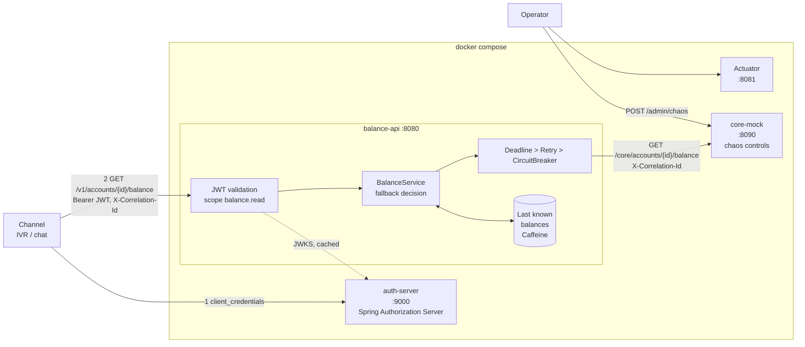
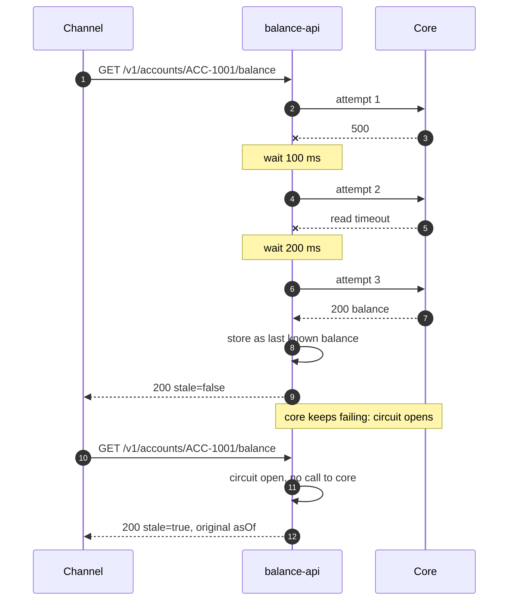

# Plan 001: Balance Gateway

| | |
|---|---|
| Spec | [spec.md](spec.md) |
| Tasks | [tasks.md](tasks.md) |
| Decisions | [docs/adr/](../../docs/adr/) |

## Summary

Three Spring Boot services in one Maven multi-module build, started with Docker Compose. `balance-api` is a servlet application on virtual threads that validates JWTs issued by `auth-server`, calls `core-mock` with `RestClient`, and wraps that call in a total deadline, a retry and a circuit breaker (Resilience4j). On failure it serves the last known balance from an in-memory cache, marked stale, or a `503` Problem Details response.

## Stack

| Concern | Choice | Version |
|---|---|---|
| Language | Java | 21 |
| Framework | Spring Boot | 4.2.0 |
| Authorisation server | Spring Authorization Server (via `spring-boot-starter-security-oauth2-authorization-server`) | managed by Boot |
| Resource server | Spring Security (`spring-boot-starter-security-oauth2-resource-server`) | 7.2.x, managed by Boot |
| HTTP client | `RestClient` (Spring Framework, `spring-boot-starter-restclient`) on the JDK `HttpClient` | 7.1.x, managed by Boot |
| Resilience | Resilience4j (`resilience4j-spring-boot4`) | 2.4.0 |
| Cache | Caffeine | managed by Boot |
| API description | springdoc-openapi (`springdoc-openapi-starter-webmvc-ui`) | 3.2.1 |
| Observability | Spring Boot Actuator, Micrometer, Boot structured logging (ECS JSON) | managed by Boot |
| Tests | JUnit 5, Mockito, AssertJ, `spring-security-test`, WireMock (`wiremock-standalone`) | Boot-managed; WireMock 3.13.2 |
| Build | Maven Wrapper, Surefire, Failsafe | Maven 3.9.16 |
| Runtime | Docker Compose, `eclipse-temurin:21` Alpine images | |
| CI | GitHub Actions | |

Spring Boot 4.2.0 (Spring Framework 7.1, Spring Security 7.2, Jackson 3) is the current stable line, released on 2026-11-19 and supported until the end of 2027. Java 21 is within its supported range (17 to 27). The libraries outside the Spring portfolio were checked against it: Resilience4j 2.4.0 ships a dedicated `resilience4j-spring-boot4` module (which registers the circuit breaker health indicator against Boot 4's relocated health API), and springdoc 3.2.1 is built on Boot 4.2.0.

Differences from Boot 3 that shape the code:

- Auto-configuration is split into small modules with matching starters. This plan uses the new names: `spring-boot-starter-webmvc`, `spring-boot-starter-restclient`, `spring-boot-starter-security-oauth2-resource-server`, `spring-boot-starter-security-oauth2-authorization-server`, and a `-test` starter per technology (`spring-boot-starter-webmvc-test`, `spring-boot-starter-security-test`).
- Jackson 3 (`tools.jackson.*` packages) is the default JSON library. DTOs are records and need no Jackson annotations.
- `@WebMvcTest` moved to `org.springframework.boot.webmvc.test.autoconfigure`; mocks in tests use `@MockitoBean` (`@MockBean` is gone).
- The health contributor API moved to `org.springframework.boot.health.contributor`. Application code does not implement indicators, so only the Resilience4j module touches it.

## Modules

```
balance-gateway/
├── pom.xml                 parent: dependency and plugin management, Surefire/Failsafe split
├── docker-compose.yml
├── .env.example
├── auth-server/            Spring Authorization Server, configuration only
├── balance-api/            the gateway
├── core-mock/              core banking simulator with chaos controls
├── docs/adr/               architecture decision records
└── specs/001-balance-gateway/
```

A single multi-module build was chosen over three independent projects: one wrapper, one `./mvnw verify` for CI, versions pinned once in the parent. Each module still produces its own image.

### auth-server (port 9000)

- No application code beyond the main class; everything is in `application.yml` through Boot's `spring.security.oauth2.authorizationserver.*` properties.
- Fixed issuer (`http://localhost:9000` locally, `http://auth-server:9000` in Docker) so tokens requested from the host validate inside the Compose network.
- Clients, `client_secret_basic`, grant type `client_credentials` only, access token TTL 5 minutes:
  - `ivr-channel`: scope `balance.read`.
  - `reporting`: scope `reporting.read`.
- Secrets from `IVR_CLIENT_SECRET` and `REPORTING_CLIENT_SECRET`, stored with the `{noop}` encoder (see Limitations in the README).
- Signing key: RSA key pair generated at startup by Boot's auto-configuration; JWKS at `/oauth2/jwks`. The key changes on restart, which invalidates outstanding tokens.

### core-mock (port 8090)

| Method and path | Behaviour |
|---|---|
| `GET /core/accounts/{accountId}/balance` | `200 {accountId, balance, currency, asOf}` for `ACC-1001`..`ACC-1004`, `404` otherwise. `asOf` is the time of the read. |
| `GET /admin/chaos` | Current chaos settings. |
| `POST /admin/chaos` | `{latencyMs (0..60000), errorRatePercent (0..100), down}`; omitted fields default to no chaos. Applies to subsequent balance requests. |
| `DELETE /admin/chaos` | Resets to `{0, 0, false}`. |

Order of chaos effects on a balance request: `down` returns `503` immediately; otherwise the latency is added, then the request fails with `500` with probability `errorRatePercent`. Logs the received `X-Correlation-Id` in its MDC so a request can be followed across both services.

### balance-api (port 8080, management 8081)

```
io.github.jcorta.balancegateway.api
├── BalanceApiApplication
├── balance/        BalanceController, BalanceResponse, BalanceService, AccountBalance,
│                   LastKnownBalanceCache, AccountNotFoundException, BalanceUnavailableException
├── core/           CoreBalanceClient, ResilientCoreBalanceClient, CoreClientConfiguration,
│                   CoreProperties, CoreUnavailableException, ResilienceEventLogger
├── security/       SecurityConfiguration, ProblemDetailsAuthenticationEntryPoint,
│                   ProblemDetailsAccessDeniedHandler
└── web/            ApiExceptionHandler, CorrelationIdFilter, OpenApiConfiguration
```

Request flow:

1. `CorrelationIdFilter` (first filter) accepts `X-Correlation-Id` if it matches `[A-Za-z0-9-]{1,64}`, otherwise generates a UUID; puts it in the MDC and the response header.
2. Spring Security validates the bearer JWT (signature against the JWKS, `iss`, `exp`, `nbf`) and requires authority `SCOPE_balance.read`.
3. `BalanceController` validates the account id (`[A-Za-z0-9-]{1,34}`) and calls `BalanceService`.
4. `BalanceService` calls `ResilientCoreBalanceClient`. On success it stores the balance in `LastKnownBalanceCache` and returns it with `stale: false`. On `CoreUnavailableException` it returns the cached balance with `stale: true` and its original `asOf`, or throws `BalanceUnavailableException` (`503`). `AccountNotFoundException` propagates (`404`) and never triggers the fallback.
5. `ResilientCoreBalanceClient` composes `TimeLimiter(Retry(CircuitBreaker(CoreBalanceClient::fetch)))` and translates every failure except "account not found" and other core `4xx` into `CoreUnavailableException`.
6. `CoreBalanceClient` performs the HTTP call with `RestClient`, forwards `X-Correlation-Id` from the MDC, maps core `404` to `AccountNotFoundException`.

Virtual threads are enabled with `spring.threads.virtual.enabled: true`: Tomcat runs each request on a virtual thread, so a thread blocked on the core costs almost nothing and the code stays synchronous. The deadline executor is also a virtual-thread-per-task executor.

## Architecture





## API contract

`GET /v1/accounts/{accountId}/balance`

| Header | |
|---|---|
| `Authorization: Bearer <JWT>` | Required. Token must carry scope `balance.read`. |
| `X-Correlation-Id` | Optional. Echoed in the response; generated when absent or malformed. |

`200 OK`, `Cache-Control: no-store`:

```json
{
  "accountId": "ACC-1001",
  "balance": 152300.75,
  "currency": "ARS",
  "asOf": "2026-11-26T14:03:12.481Z",
  "stale": false
}
```

`balance` is serialised from `BigDecimal`; `asOf` is the instant at which the core produced the balance, and is preserved when the balance is served stale.

| Status | When | Problem `type` |
|---|---|---|
| `400` | Malformed account id | `urn:balance-gateway:problem:invalid-request` |
| `401` | Missing, expired, tampered or foreign token. `WWW-Authenticate: Bearer` is kept. | `urn:balance-gateway:problem:unauthenticated` |
| `403` | Valid token without `balance.read` | `urn:balance-gateway:problem:forbidden` |
| `404` | Core does not know the account | `urn:balance-gateway:problem:account-not-found` |
| `502` | Core rejected the request with another `4xx` (contract error between gateway and core) | `urn:balance-gateway:problem:core-rejected-request` |
| `503` | Core unavailable and no last known balance within the maximum age | `urn:balance-gateway:problem:balance-unavailable` |
| `500` | Unexpected error | `urn:balance-gateway:problem:internal-error` |

Error body (`Content-Type: application/problem+json`):

```json
{
  "type": "urn:balance-gateway:problem:balance-unavailable",
  "title": "Balance unavailable",
  "status": 503,
  "detail": "The core banking system is unavailable and no recent balance is known for this account.",
  "instance": "/v1/accounts/ACC-1001/balance",
  "correlationId": "5f0c6c0e-6f1e-4a4e-9a65-2f0f0f6a8b51"
}
```

Problem types are URNs because there is no published documentation site to resolve them against. `detail` never contains exception messages.

## Resilience configuration

Assumptions, to be replaced by measured values in a real deployment: the IVR allows about 3 s per back-end step; the core answers within 300 ms at p99 when healthy; channel traffic is bursty, so many calls fail at the same time when the core fails.

| Setting | Value | Reason |
|---|---|---|
| `balance.core.connect-timeout` | 250 ms | Connection setup inside the data centre is fast; a slow connect means the core host is unhealthy. |
| `balance.core.read-timeout` | 700 ms | About twice the healthy p99. Long enough not to cut healthy-but-slow answers, short enough to fit two attempts in the budget. |
| `resilience4j.retry.instances.core.max-attempts` | 3 (1 call + 2 retries) | More attempts add load to a struggling core and cannot fit the budget anyway. |
| `wait-duration`, exponential multiplier | 100 ms, ×2 (100 ms, 200 ms), randomised ±50 % | Backoff gives a transient fault time to clear; jitter stops synchronised retry waves from all channels. |
| `retry-exceptions` | `HttpServerErrorException` (5xx), `ResourceAccessException` (I/O, connect and read timeouts) | Faults that a repetition can plausibly fix. |
| Not retried | `AccountNotFoundException`, `HttpClientErrorException` (4xx), `CallNotPermittedException` (circuit open), unreadable body | A repetition gives the same answer; retrying an open circuit defeats it. |
| `resilience4j.circuitbreaker.instances.core` | count-based window of 10 calls, minimum 5 calls, failure rate threshold 50 % | Reacts within two or three failing requests (each makes up to 3 calls) without opening on a single blip. |
| `wait-duration-in-open-state` | 15 s | Gives the core room to recover; short enough that channels get current balances back quickly. |
| `permitted-number-of-calls-in-half-open-state` | 2 | A small probe before restoring full traffic. |
| `automatic-transition-from-open-to-half-open-enabled` | true | The state is visible in health and metrics without waiting for traffic. |
| `ignore-exceptions` | `AccountNotFoundException`, `HttpClientErrorException` | Client errors say nothing about the core's health. |
| `resilience4j.timelimiter.instances.core.timeout-duration` | 2 s | Total budget for one request, including all attempts and waits. Leaves 1 s of the IVR's step budget for network and the channel itself. |
| `cancel-running-future` | true | The in-flight attempt is interrupted; on a virtual thread, blocking socket I/O is interruptible, so the connection is released. |
| `balance.fallback.max-age` | 10 min | A business decision placeholder: how old a balance may be and still be read out to a customer as "last known". |
| `balance.fallback.max-entries` | 100 000 | Bounds memory. Entries are a few hundred bytes. |

Worst case without the deadline: 3 × (250 + 700) ms + 300 ms of waits ≈ 3.15 s, which exceeds the budget; the deadline is therefore the guarantee, and the per-attempt timeouts decide how many attempts fit in it (two complete attempts in a full-hang scenario).

### Order of the decorators

`TimeLimiter( Retry( CircuitBreaker( call ) ) )`, composed explicitly in `ResilientCoreBalanceClient` (see [ADR-0002](../../docs/adr/0002-retry-outside-circuit-breaker.md)):

- The circuit breaker is innermost, so it records every attempt. Sustained failures open it quickly, and once open, the retry sees `CallNotPermittedException`, which is not retryable, and gives up at once.
- The retry sits outside the circuit breaker so that one logical request can survive a transient failure.
- The time limiter is outermost: it bounds the whole request, retries included.

The registries and their configuration come from the Resilience4j Spring Boot starter (`application.yml`); the composition is programmatic rather than annotation-based. Annotations hide the order in aspect-order properties, `@TimeLimiter` only supports asynchronous return types, and AOP proxies do not apply on self-invocation. With explicit composition, the order is readable in one method and unit-testable without Spring.

The deadline runs the retry chain on a virtual thread. The MDC does not cross threads, so `ResilientCoreBalanceClient` copies the MDC into the task to keep the correlation id on the outbound call and in the retry logs.

## Security

- `balance-api` is an OAuth 2.0 resource server. Configuration: `issuer-uri` (enables `iss` validation) and `jwk-set-uri` (keys fetched lazily on the first request and cached by Nimbus, so the API starts even if the auth server is down). See [ADR-0004](../../docs/adr/0004-client-credentials-and-scopes.md).
- Authorisation rule: `GET /v1/accounts/**` requires `SCOPE_balance.read`. OpenAPI and Swagger UI are public; everything else on port 8080 is denied.
- Actuator lives on management port 8081, which is meant to be reachable only from inside the network (not published through the ingress in production). It is unauthenticated in this implementation. The same filter chain applies on both ports; Actuator endpoints are permitted through `EndpointRequest.toAnyEndpoint()`. Spring Security 7 adds a `resource_metadata` parameter to the `WWW-Authenticate` challenge (OAuth 2.0 Protected Resource Metadata).
- 401 and 403 responses are written as Problem Details by a custom `AuthenticationEntryPoint` (which delegates to `BearerTokenAuthenticationEntryPoint` to keep `WWW-Authenticate`) and `AccessDeniedHandler`.
- Stateless: no session, no CSRF (no cookies, bearer tokens only).

## Observability

- Health on 8081: `/actuator/health` shows the `circuitBreakers` component (state per breaker) with `register-health-indicator: true`, `allow-health-indicator-to-fail: false` and `management.endpoint.health.show-details: always` (needed for the component to appear in the composite endpoint; also available alone at `/actuator/health/circuitBreakers`), so an open circuit is reported but does not turn the service `DOWN`; the core being unavailable is not a reason to restart or de-route the gateway, which is still answering. While the circuit is open the component reports `CIRCUIT_OPEN` (status `UNKNOWN`) and the overall status stays `UP`. Probes use `/actuator/health/liveness` and `/actuator/health/readiness`, which do not include the circuit breaker.
- Actuator endpoints exposed: `health`, `info`, `metrics`, `circuitbreakers`, `circuitbreakerevents`, `retries`, `retryevents`.
- Metrics: Resilience4j Micrometer metrics (`resilience4j.circuitbreaker.state`, `resilience4j.circuitbreaker.calls`, `resilience4j.retry.calls`), HTTP server and client metrics from Boot, and a counter `balance.fallback` tagged `outcome=stale|unavailable`.
- Logs: Spring Boot structured logging, ECS format, in the `docker` profile; human-readable pattern with the correlation id in the `local` profile. MDC key `correlationId`. `ResilienceEventLogger` logs each retry (attempt number, wait, cause) and every circuit breaker state transition.

## Configuration and profiles

| Profile | Use | Differences |
|---|---|---|
| `local` (default) | Running from the IDE or `./mvnw spring-boot:run` | `localhost` URLs, human-readable logs |
| `docker` | Docker Compose | Service-name URLs, JSON logs |

Integration tests use a test-only profile `it` (`src/test/resources/application-it.yml`: 300 ms read timeout, 10 ms retry wait, 1 s open state) and register the WireMock URL with `@DynamicPropertySource`, so the suite stays fast while exercising the same configuration keys.

## Containers

- One `Dockerfile` per module, built from the repository root (the build needs the parent POM).
- Multi-stage: `eclipse-temurin:21-jdk-alpine` builds with `./mvnw -pl <module> -am package -DskipTests` using a BuildKit cache mount for `~/.m2`; `eclipse-temurin:21-jre-alpine` runs the application extracted with `-Djarmode=tools` (layered, faster startup).
- Non-root user, `HEALTHCHECK` with BusyBox `wget`: `auth-server` on `/oauth2/jwks`, `core-mock` and `balance-api` on Actuator liveness.
- Compose: `balance-api` `depends_on` both services with `condition: service_healthy`. Secrets from `.env` (template in `.env.example`).

## Test strategy

| Level | Class | Covers |
|---|---|---|
| Unit | `BalanceServiceTest` | Fallback decision: current, stale, unavailable, not found (US1-AC1, US1-AC2, US4-AC1..3) |
| Unit | `LastKnownBalanceCacheTest` | Maximum age with a controllable ticker (US4-AC2) |
| Unit | `ResilientCoreBalanceClientTest` | Real Resilience4j objects, mocked core client: deadline bounds a hanging core, open circuit is not retried (US3-AC3, US3-AC4) |
| Unit | `CorrelationIdFilterTest` | Reuse valid id, replace missing or malformed id (US5-AC3, US5-AC4) |
| Slice | `BalanceControllerTest` (`@WebMvcTest`, filters off) | 200, 400 (including the 34 and 35 character boundary), 404, 502, 503, 500 without internal details, stale response, Problem Details shape, `Cache-Control` (US1, US4, NFR-5) |
| Slice | `BalanceSecurityTest` (`@WebMvcTest`, `spring-security-test`) | 401 without token, 401 on a token the decoder rejects, 403 without the scope or without any scope, 200 with the scope (alone or among others), every other path denied, Problem Details body and `WWW-Authenticate` (US2-AC1..AC3, NFR-5) |
| Integration | `BalanceResilienceIT`, `BalanceDeadlineIT` | WireMock core over HTTP: OK, retry on 5xx, retry on timeout, no retry on 4xx, circuit opens on sustained 5xx and stops calling the core, recovery through half-open, stale fallback (also while the circuit is open), 503 without cache, deadline with a hanging core, correlation id forwarded (US1, US3, US4, US5-AC3) |
| Integration | `JwtValidationIT` | Real tokens signed with a test RSA key, JWKS served by WireMock: expired, wrong issuer, unknown signing key, malformed → 401; valid → 200; missing scope → 403; unauthorised requests never reach the core; keys cached after the first fetch (US2-AC1..AC3) |
| Integration | `ObservabilityIT` | Liveness `UP` while circuit open, circuit breaker state in health, metrics present, OpenAPI document content (US5-AC1, US5-AC2, US7-AC1) |
| Integration | `AuthServerIT` (auth-server) | `ivr-channel` gets an RS256 JWT with `balance.read` that verifies against the published JWKS, 5-minute lifetime, no scope unless requested; `reporting` cannot obtain `balance.read`; wrong secret and other grant types rejected (US2-AC4) |
| Integration | `ResilienceConfigurationIT` | The values of `application.yml` without overrides match this plan: timeouts, retry policy, circuit breaker, fallback limits |
| Slice | `CoreBalanceControllerTest`, `ChaosControllerTest` (core-mock) | Balance, 404, outage, error rate, reset (US6-AC1, US6-AC2) |
| Demo | README "Reproduce degradation" | End to end in Compose, including core-side logs and recovery (US5-AC3, US5-AC5, US6-AC3, SC-3) |

One WireMock server (dynamic port, started once per JVM) plays the core and the JWKS endpoint for all integration tests, so Spring contexts with the same configuration are reused. The standalone artifact is used because it shades Jetty and does not conflict with Boot's dependency management.

## Decisions

| Decision | Chosen | Rejected alternatives | Record |
|---|---|---|---|
| HTTP client to the core | `RestClient` on JDK `HttpClient` | `RestTemplate` (maintenance mode), `WebClient` (reactive stack not needed with virtual threads), declarative `@HttpExchange` interface (extra indirection for one call) | [ADR-0001](../../docs/adr/0001-restclient-for-core-calls.md) |
| Decorator order | Deadline > Retry > Circuit breaker, composed programmatically | Circuit breaker outside retry; annotation-based composition | [ADR-0002](../../docs/adr/0002-retry-outside-circuit-breaker.md) |
| Degradation | Last known balance from a local cache, `stale: true`, bounded age; `503` otherwise | Fail fast with `503` always; serve cache without age limit; distributed cache | [ADR-0003](../../docs/adr/0003-stale-balance-fallback.md) |
| System-to-system authentication | OAuth 2.0 client credentials, scopes, JWT validated locally against JWKS | API keys; opaque tokens with introspection; mTLS only | [ADR-0004](../../docs/adr/0004-client-credentials-and-scopes.md) |
| Concurrency model | Servlet stack on virtual threads | Platform thread pool sized for core latency; WebFlux | This plan |
| Cache | Caffeine with size and age bounds | `ConcurrentHashMap` (unbounded, manual expiry) | This plan |
| Management port | Separate port 8081 | Same port with authenticated Actuator | This plan |
| Build layout | Maven multi-module | Three independent projects | This plan |

## Risks and limitations

- The fallback cache is per instance and empty after a restart; see ADR-0003.
- Virtual threads on Java 21 are pinned to their carrier while inside `synchronized` blocks (fixed in Java 24, JEP 491). No such blocking path is known in this call chain; pinning can be observed with `-Djdk.tracePinnedThreads=full`.
- When the deadline cancels the request, the cancelled attempt may already have reached the core. Harmless for a read; for writes, idempotency keys would be required (out of scope).
